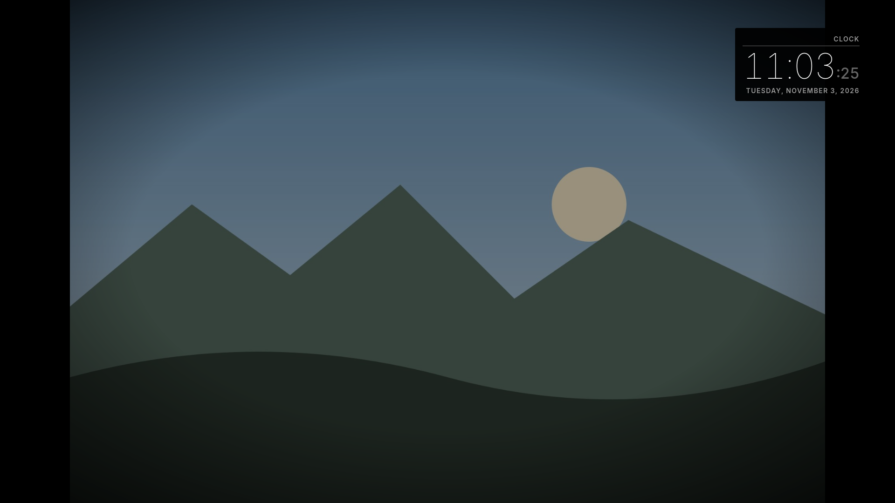

# mirrordash-photos

A photo slideshow for [MirrorDash](https://github.com/Menturan/MirrorDash): photos you upload in the
module's settings, an [Immich](https://immich.app) album, or a photo service on the internet (Unsplash,
Pexels, NASA's Astronomy Picture of the Day, Wikimedia's Picture of the Day).

Put it in a corner as a framed photo, or in the **Background** position to show it behind the other
modules (MirrorDash 0.12 or newer).



## Sources

Choose one under **Modules → Photos → Source**. The settings of the other sources are kept.

| Source | What you need | Notes |
| :--- | :--- | :--- |
| Photos uploaded here | Nothing | **Photos → Add photos** in the settings (save the module once first). Your phone shrinks each photo to the mirror's screen before sending it, without its location, and puts its date first in its name, so *By date taken* sorts them. At most 500. Uploaded photos aren't in the mirror's backups: keep your originals. |
| Immich | Its address and an API key | **Immich Address**: as you open Immich at home (`http://192.168.1.10:2283`); the mirror lets the module reach that address and nothing else at home. **Immich API Key**: in Immich, your account → *Account Settings* → *API Keys* → *New API Key*. Then an album (its ID is the last part of the album's address in Immich), random photos, or memories. |
| Unsplash | A free Access Key | At [unsplash.com/developers](https://unsplash.com/developers): *Your apps* → *New Application*, accept the terms, and copy its **Access Key** (not the Secret Key). A search (`northern lights`) or collection IDs choose the photos. The demo key allows 50 requests an hour, so a photo is shown for 90 seconds at least. |
| Pexels | A free API key | At [pexels.com/api](https://www.pexels.com/api/): sign in and copy **Your API Key**. With a search, or Pexels' own picks. |
| NASA: Astronomy Picture of the Day | Nothing | Today's picture (on a video day, the newest picture before it). An own key from [api.nasa.gov](https://api.nasa.gov) is optional. |
| Wikimedia: Picture of the Day | Nothing | Today's picture from Wikimedia Commons. |

Keys are sent only to their service, in a request header; the mirror never logs them.

**Credit.** Unsplash, Pexels and the pictures of the day show a small line with the photographer and the
service (*Photo: Name / Unsplash*), as their terms ask. Photos from Unsplash are loaded straight from
Unsplash, and each one shown is reported to Unsplash once, as its terms ask too.

## Settings

| Setting | |
| :--- | :--- |
| Seconds per Photo | How long each photo is shown (default 60). |
| Order | Your own photos and Immich: by date taken, as added, or shuffled (each once before any again). |
| Darker Edges | Darkens the photo towards the edges, so text over it stays readable. Good in Background. |
| Orientation | Unsplash and Pexels: only landscape or portrait photos, to match your screen. |
| Opacity (the mirror's own setting) | How bright the photo is. Behind other modules, about 0.5–0.7 keeps the mirror a mirror. |

A photo is shown whole, never cropped: on a two-way mirror the black around it is glass. A new photo fades
in once; nothing else moves.

## Privacy

Your own photos (uploaded or from Immich) reach the screen through the module's own address on the mirror,
which answers only the mirror's own screen: another device on your network gets nothing.

## Develop

```bash
uv run pytest                    # the module's tests
uvx mirrordash-sdk validate .    # checks the module before you push it
```

Try it on a local mirror: see the [MirrorDash SDK](https://github.com/Menturan/mirrordash-sdk#quick-start).
